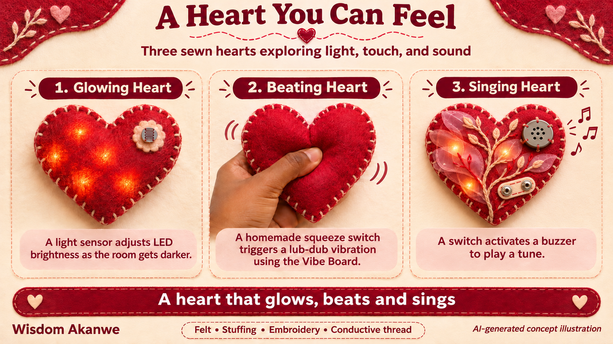
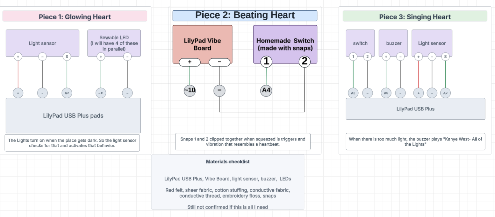

# A Heart You Can Feel

### A heart that glows, beats and sings

For my final project, I want to make three soft fabric hearts that respond through light, vibration, and sound. I like the idea of taking a familiar shape and giving each version a different way to interact with someone.

**Glowing Heart**

The first heart will have LEDs that respond to a light sensor. When the surroundings get darker, the heart will light up. I plan to place the LEDs around the heart and use embroidery to decorate its surface.

**Beating Heart**

The second heart will use a Vibe Board to produce a “lub-dub” vibration resembling a heartbeat. A homemade switch inside the heart will activate the vibration when squeezed, making the heartbeat something you can feel.

**Singing Heart**

The third heart will use a buzzer to play a tune when its switch is turned on. This adds sound to the collection and gives the heart another way to express itself.

I will use felt, stuffing, decorative thread, and conductive thread to build the hearts and sew their electronic connections. My goal is to bring together what I have learned about sewing, sensors, and Arduino programming to create a heart that glows, beats and sings.

*The proposal concept image was created with assistance from OpenAI’s ChatGPT image-generation tool.*

