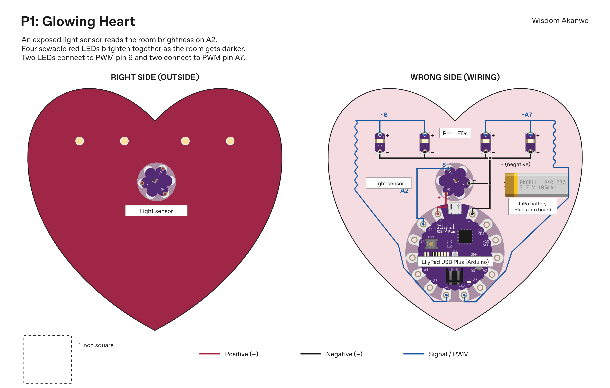
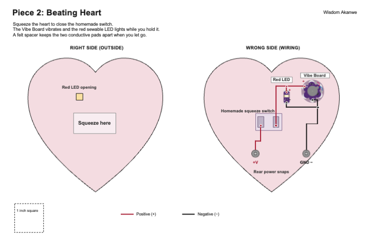
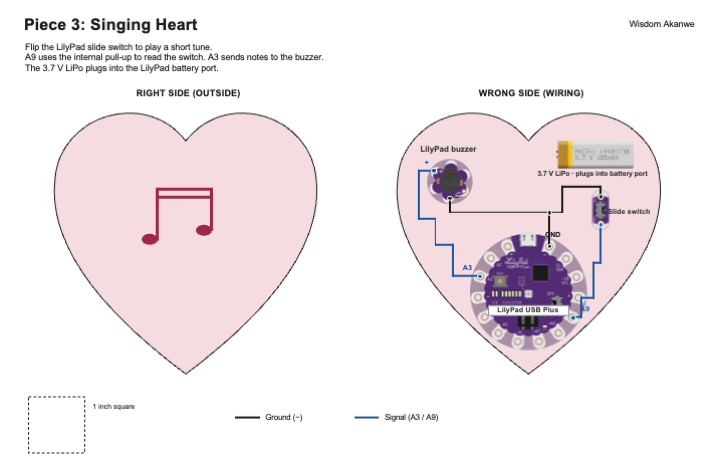

{: .box-success}
Three hearts, three different ways to bring them to life.

**Description**

For this project, I’m making three felt hearts. I started by drawing the front and back of each heart so I could figure out where the electronics and stitches would go.

The first heart glows. It has four red LEDs and a light sensor that lets the LilyPad make the LEDs brighter as the room gets darker. The second heart beats. When I squeeze it, two conductive fabric pads touch and close the circuit. The battery powers the Vibe Board and a red LED until I let go. The third heart sings. It has music notes on the front and a buzzer on the back. Since I only have one LilyPad, my plan is to move it from the Glowing Heart to the Singing Heart when I want the slide switch to play a tune(A.

