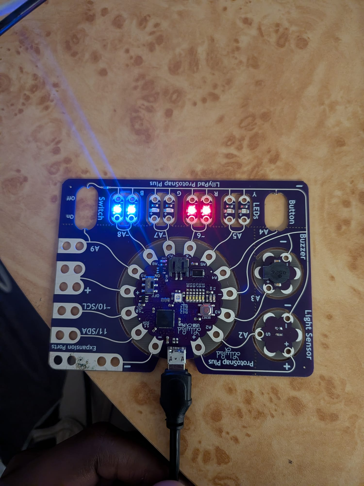

{: .box-success}
This time, my Arduino gets to decide which lights turn on.. and how bright they get!

## Light it ##

For this assignment, I used two arrays: one for the PWM pins and another to remember which ones were on or off. Every second, the program randomly picks a pin. If it is on, it turns off. If it is off, it gets a random brightness. So I never really know what the lights will do next :)

## Tips ##

The pin number and its position in the array are different things! Keep track of the position so you turn off the right pin.

Now, to see the lights in action!

